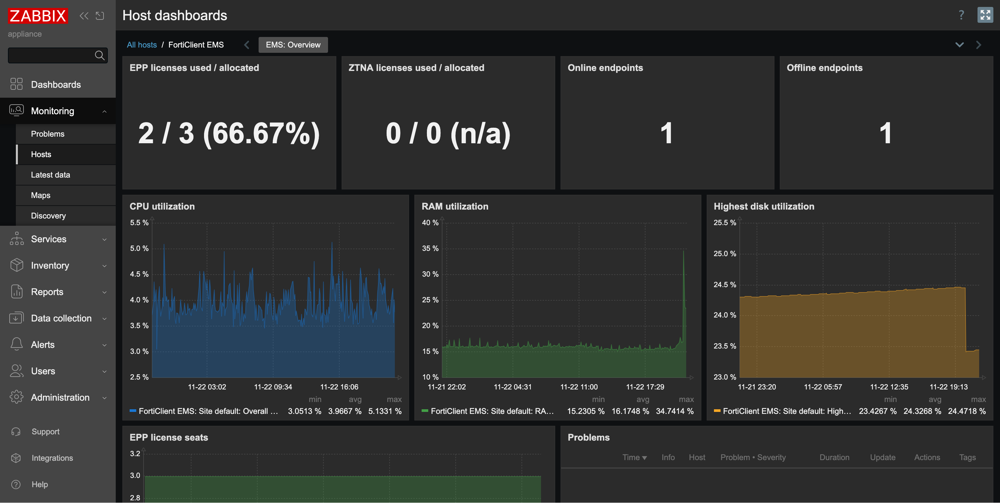
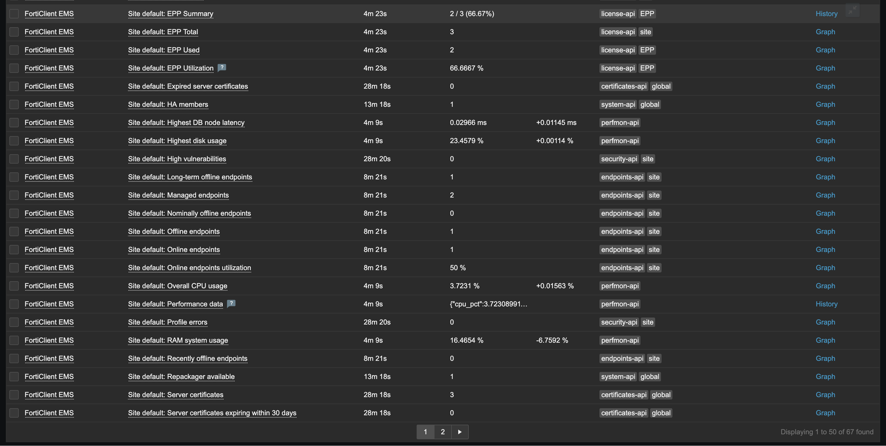
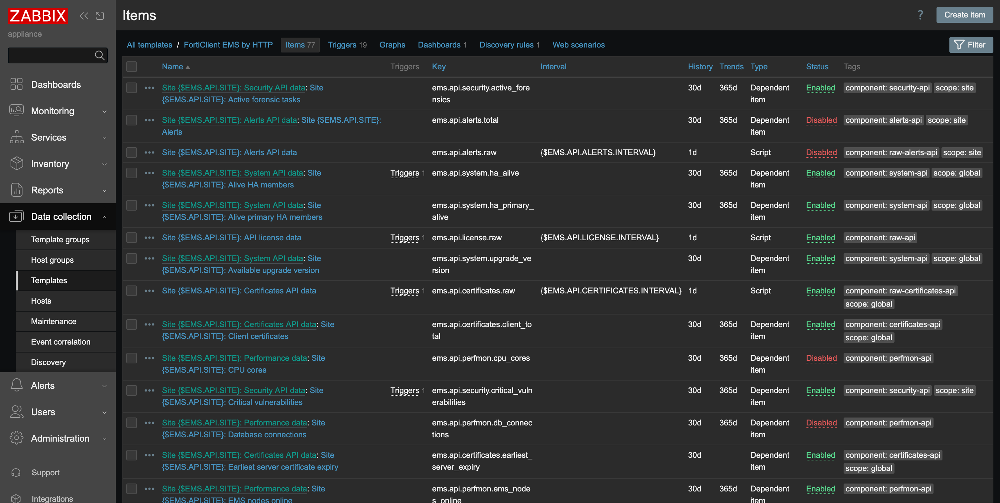
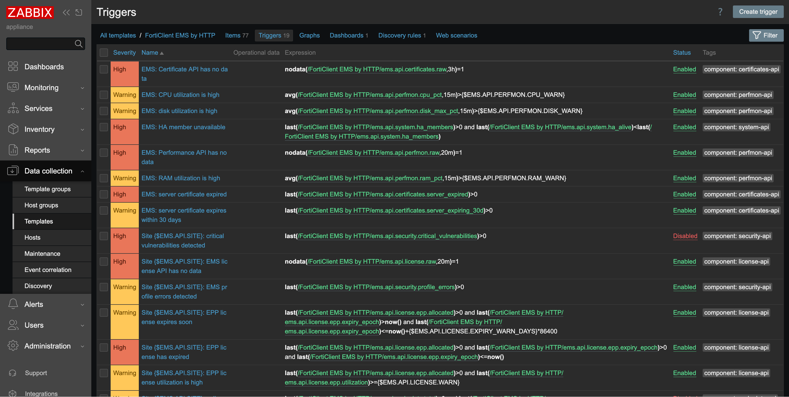

# FortiClient EMS by HTTP

Zabbix 7.0 template for FortiClient EMS 7.4.8 monitoring over HTTPS. Import [template_forticlient_ems_http.yaml](template_forticlient_ems_http.yaml). No SNMP interface is required.

Template vendor is **Nilleftw** (maintainer), with version **7.0-0** for the first numbered revision on the Zabbix 7.0 branch. This is a template revision, not an EMS version or a required Zabbix patch level. Template tags are `class: software`, `target: forticlient-ems`, and `target: fortinet`.

## Screenshots

Example data from a FortiClient EMS 7.4.8 lab monitored with Zabbix 7.0.32.

More screenshots: latest data, items, and triggers

### Latest data

### Template items

### Template triggers

## Setup

Create one Zabbix host per EMS site and set these host macros:

| Macro | Value |
|---|---|
| `{$EMS.API.URL}` | EMS base URL, for example `https://ems.example.com` |
| `{$EMS.API.SITE}` | Site name, such as `default` |
| `{$EMS.API.USERNAME}` | EMS account with access to the selected site |
| `{$EMS.API.PASSWORD}` | Password stored as **Secret text** |
| `{$EMS.API.PERFMON.EXTENDED}` | `0` by default; set to `1` to query optional diagnostic series |

Item names show the resolved site name in Latest data. The template does not add a `site:{$EMS.API.SITE}` item tag because Zabbix displays user macros in item tags literally in that view. If site-based problem routing is needed, set a literal host tag such as `site:default` on each EMS host.

The script normalizes an explicit default HTTPS port (`:443`) before setting the Origin and Referer headers. This avoids an EMS CSRF rejection observed with `https://host:443`.

Each collection group has one Script master item and dependent metrics. **Disable a group's master item to stop its API requests.** Disabling a dependent item only stops storing that metric; its master still polls. Polling intervals are controlled by the corresponding `{$EMS.API.<GROUP>.INTERVAL}` template macro.

| Group | Master key | Default interval | Scope | Default state | Data |
|---|---|---:|---|---|---|
| License | `ems.api.license.raw` | 5m | Site | Enabled | EPP, ZTNA, all active license types, trial status |
| Endpoints | `ems.api.endpoints.raw` | 10m | Site | Enabled | Total, online, offline, managed, unmanaged |
| Security | `ems.api.security.raw` | 30m | Site | Enabled | Vulnerabilities, affected endpoints, profile/tag errors, active forensics |
| Performance | `ems.api.perfmon.raw` | 5m | Global | Enabled | CPU, RAM, highest disk usage, EMS node count, database latency; optional diagnostics |
| System | `ems.api.system.raw` | 15m | Global | Enabled | HA members, signature update and upgrade status; optional repackager status |
| Certificates | `ems.api.certificates.raw` | 1h | Global | Enabled | Server certificate count and expiry; optional client certificate count |
| Alerts | `ems.api.alerts.raw` | 10m | Site | Disabled | Alert count and unread alerts for the API account |
| Inventory | `ems.api.inventory.raw` | 1h | Global | Disabled | Site and workgroup counts |

The Alerts and Inventory master and dependent items are disabled by default because unread alerts are account-specific and site/workgroup counts rarely change. Performance swap, duplicate online-endpoint count, and CPU-core count are also disabled. The Performance script does not query swap or the duplicate endpoint count. Database connection count, network rates and connections, keep-alive metrics, and per-process CPU/RAM are optional diagnostics: their items are disabled and their Grafana queries are skipped by default. To collect them, set `{$EMS.API.PERFMON.EXTENDED}` to `1` and enable the desired dependent items. The client certificate count is optional because its endpoint may reject non-super-administrator accounts; set `{$EMS.API.CERTIFICATES.CLIENT.ENABLED}` to `1` and enable `ems.api.certificates.client_total` to collect it. The cloud repackager status request is also optional because it may time out and prevent the other system metrics from updating. To collect it, set `{$EMS.API.SYSTEM.REPACKAGER.ENABLED}` to `1` and enable `ems.api.system.repackager_available`. For multi-site EMS, enable the global groups on only one host to avoid collecting the same data repeatedly.

### EMS administrator permissions

The template was tested with FortiClient EMS 7.4.8. In a non-multitenant lab, a temporary custom role cloned from Read-only Administrator returned HTTP 200 for `license/get` and `server_certificates/index`, but HTTP 403 for `client_certificates/index`, `sites/names/index`, and `performance_dashboard/login`. Enabling CA certificate management, EMS settings management, and finally **every selectable permission** on that custom role did not change those three HTTP 403 responses. Super Administrator returned HTTP 200 for all three. Fresh sessions were used after each role change, and the temporary user and role were deleted after testing. This strongly indicates that those three routes require the Super Administrator role in EMS 7.4.8 rather than an individual selectable permission. Recheck after EMS upgrades.

For a read-only account, leave client certificate collection and inventory disabled, and disable `ems.api.perfmon.raw` and its no-data trigger; CPU, RAM, disk, and other performance items will not update. The certificate client-count request is disabled by default so that a denied request does not block server certificate expiry data. Inventory is disabled by default. The optional repackager endpoint may time out independently of permissions. The `Global` scope in the table means that a metric describes the EMS server rather than one site; it does not imply that multitenancy is enabled.

The disk item is the highest usage across all returned volumes, including `/boot` when present. The API data identifies disk devices rather than mount points, so the template does not exclude `/boot` automatically. A full boot partition can also prevent upgrades. Use host-level disk monitoring when mount-specific alerts are needed.

## License discovery

EPP and ZTNA retain their fixed item keys. Low-level discovery adds nine metrics for each other license type with used, allocated, future, or expired seats. Types with only zero values are omitted. The raw license item stores normalized counts and dates; EMS serial numbers and host IDs are discarded. Expiry timestamps interpret EMS's timezone-free date as UTC and use `0` when no date is available.

## Triggers

The following triggers are enabled by default:

| Condition | Severity | Default |
|---|---|---|
| No license API data for 20 minutes | High | Enabled |
| No Performance API data for 20 minutes | High | Enabled |
| No Certificate API data for three hours | High | Enabled |
| EPP, ZTNA, or discovered license utilization reaches `{$EMS.API.LICENSE.WARN}` | Warning | 90% |
| Allocated license expires within `{$EMS.API.LICENSE.EXPIRY_WARN_DAYS}` | Warning | 30 days |
| Allocated license has expired | High | Enabled |
| At least one server certificate expires within 30 calendar days | Warning | Enabled |
| At least one server certificate has expired | High | Enabled |
| Fewer live HA members than configured members | High | Enabled |
| 15-minute average CPU exceeds `{$EMS.API.PERFMON.CPU_WARN}` | Warning | 85% |
| 15-minute average RAM exceeds `{$EMS.API.PERFMON.RAM_WARN}` | Warning | 90% |
| 15-minute average maximum disk usage exceeds `{$EMS.API.PERFMON.DISK_WARN}` | Warning | 90% |
| EMS profile or Zero Trust tag errors are present | Warning | Enabled |

Endpoint online percentage and critical vulnerability triggers are included but **disabled by default**; their usefulness depends on deployment policy and existing findings. If a master item is intentionally disabled, disable its no-data trigger as well. Zabbix notifications also require an action configured in Zabbix.

## Host dashboard

The template includes **EMS: Overview**, a host dashboard with an EPP license seats graph, a ZTNA license summary, a combined online/total endpoint count, CPU/RAM/disk graphs, and current problems. The endpoint total includes managed and unmanaged endpoints. The EPP graph shows used seats, capacity, and a warning line on an axis starting at zero. The warning line is calculated as capacity × `{$EMS.API.LICENSE.WARN}` / 100; for 1,000 seats and a 90% warning threshold, it appears at 900 seats. The separate EPP utilization trigger generates problems at the same percentage. CPU, RAM, and disk graphs show one series each with their simple trigger thresholds on 0–100% axes. All graphs show minimum, average, and maximum values in the legend and follow the dashboard time selector. The CPU, RAM, and disk trigger expressions evaluate 15-minute averages. Open the dashboard from the monitored host's Dashboards tab after linking the template.

## Data handling and compatibility

The template stores normalized monitoring values instead of raw EMS responses. This matters because some EMS API responses contain sensitive fields. Credentials and cookies remain inside a Script execution. Default triggers focus on API availability, license capacity and expiry, server certificate expiry, and HA availability.

The license, dashboard, and several other routes were observed in the EMS web interface; they are not all present in the supplied Fortinet OpenAPI files. See [API_COVERAGE.md](API_COVERAGE.md) for the routes used by each group. Performance collection uses EMS's internal Grafana endpoints and may need adjustments on other EMS versions. Certificate expiry comparisons use the date portion of the EMS response.

## Validation

Imported into Zabbix 7.0.32 and tested against FortiClient EMS 7.4.8. Six collection groups are enabled by default and two are optional. The license discovery created nine Chromebook items with correct values. The HTTP template provides 22 trigger definitions, including three license discovery trigger prototypes; 20 are enabled and two are disabled by default. The host dashboard imported with seven widgets; all four graphs rendered in the lab.

References: [Zabbix Script items](https://www.zabbix.com/documentation/7.0/en/manual/config/items/itemtypes/script), [dependent items](https://www.zabbix.com/documentation/7.0/en/manual/config/items/itemtypes/dependent_items), and [template import](https://www.zabbix.com/documentation/7.0/en/manual/api/reference/configuration/import).

## License

MIT. See [LICENSE](LICENSE). Maintained by Nilleftw; not an official Fortinet template.
